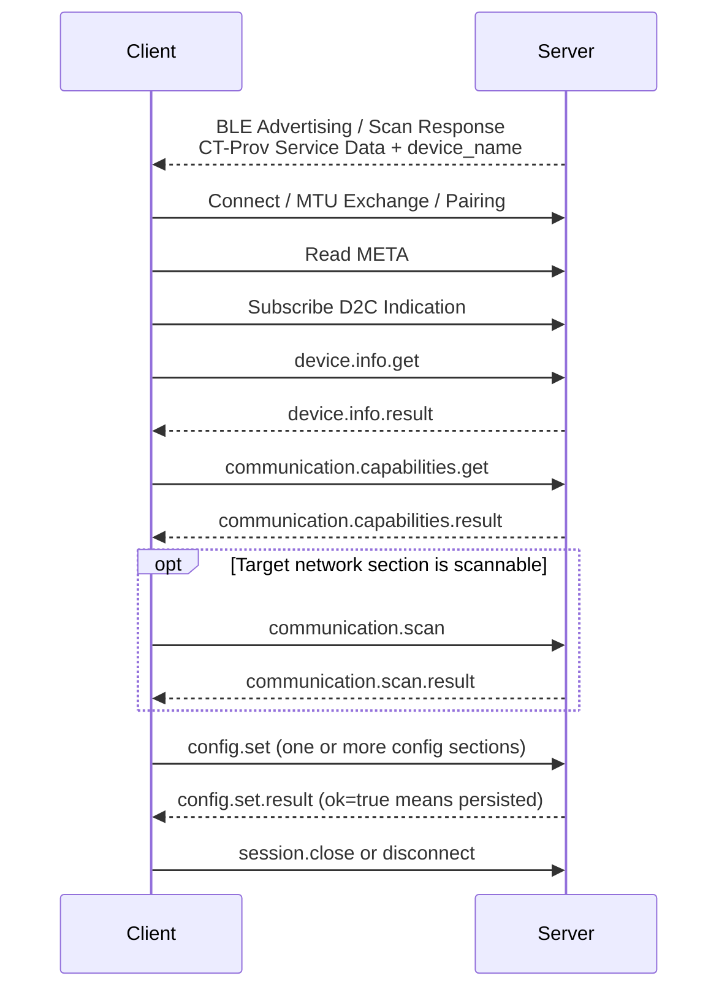
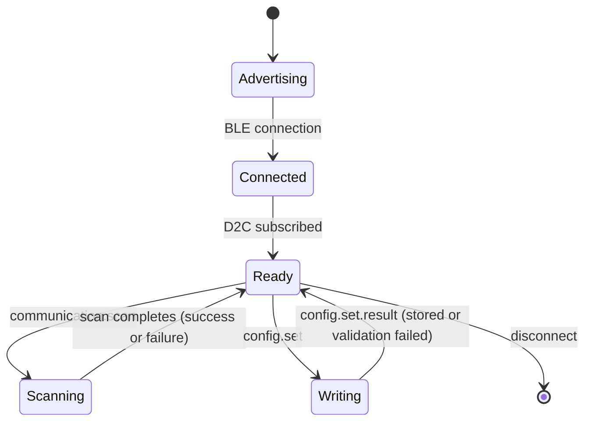

# CT-Prov/1 Communication Provisioning Protocol Specification

| Item | Value |
| --- | --- |
| Document status | Draft v2.0, interaction simplified to a transaction-free config delivery model |
| Protocol version | CT-Prov/1 |
| Updated | 2026-10-28 |
| Applies to | CT-Prov BLE Clients and Servers |
| Encoding | BLE GATT + binary fragmentation header + UTF-8 JSON |

The key words **MUST**, **MUST NOT**, **SHOULD**, and **MAY** in this document
are to be interpreted as absolute requirements, absolute prohibitions,
recommended requirements, and optional capabilities respectively.

## 1. Goals and scope

CT-Prov is a device communication provisioning protocol over BLE. It is
responsible for:

1. Discovering CT-Prov Servers and establishing a GATT connection.
2. Reading device information and the actual configuration capabilities.
3. Scanning target networks where the network section supports scanning.
4. Writing configuration parameters for Wi-Fi, cellular (CAT1), Wi-Fi HaLow,
   or Ethernet — plus MQTT and Webhook service parameters — to the device and
   persisting them.
5. Confirming, in a request-response fashion, that the configuration has been
   delivered (accepted and stored).

CT-Prov/1 is explicitly **not** responsible for:

- Verifying that a configuration takes effect: the protocol reports no
  network connection progress, address acquisition, broker connection, or
  webhook reachability results. Writing the configuration completes the
  interaction; actual connectivity is confirmed via the device's local web
  UI, its status page, or the cloud platform.
- Transaction tracking: there is no `txid`, no completion condition, no
  phase-state events, no query and no cancel. A config write is an idempotent
  overwrite; re-submitting the same configuration has no additional side
  effects.
- Specifying the client application's pages, device button
  placement/appearance, indicator LEDs, or QR code formats.
- Specifying how a device enters the discoverable state.
- Specifying the device-AP or CT-Disc transport protocols.
- Specifying cloud accounts, binding APIs, or device management features.
- Transporting images, video, OTA packages, or other large payloads over BLE.
- Treating PoE as a separate communication protocol; PoE devices use the
  `ethernet` section.
- Defining application-layer authentication, encryption, or access control;
  these are left to later versions. Link-layer encryption requirements are in
  §4.4.
- Defining static IP configuration. NE101 and NE301 implementations are both
  DHCP today; static addressing may be added by later versions as needed.
- Specifying MQTT topic systems, webhook payload formats, or event
  enumerations; those are defined by product documentation.

This document defines only the fragmentation and envelope formats, the
operation interactions, and the device state model. Field definitions,
constraints, and examples for each configuration section inside `config.set`
are in the [CT-Prov/1 Configuration Schema](./ct-config-schema.md).

CT-Prov/1 introduces no Setup ID, provisioning code, or other new device
identifiers. Advertising Data carries a model enumeration and the last 3
bytes of the device's canonical primary MAC as a local discovery hint; the
Scan Response reuses the device's existing `device_name`; after connecting,
the full identity is obtained from the device's existing `serial_number`.

## 2. Roles and terminology

| Name | Definition |
| --- | --- |
| Client | The party initiating communication provisioning; BLE Central / GATT Client |
| Server | The party receiving communication provisioning; BLE Peripheral / GATT Server |
| Configuration window | The time window in which the Server allows scanning, connection, and configuration |
| Connection | One BLE GATT connection |
| Discovery transport | The channel the client uses to find and connect the device; fixed to BLE in this document |
| Config section | A top-level configuration section in `config.set`, e.g. `wifi`, `cellular`, `mqtt`; section names correspond one-to-one with capability declarations |
| Network section | A config section that decides how the device gets online: `wifi`, `cellular`, `halow`, `ethernet` |
| Service section | A config section that decides where the device sends data: `mqtt`, `webhook`; these only take effect once some network section has connected |
| Delivery | The configuration has been written to the Server's persistent storage over an encrypted link; `ok=true` in `config.set.result` is the delivery confirmation |
| Capability | The actually writable fields a Server exposes for a config section |
| Device name | The device's existing short name, used for scan-result display and connection guidance — not device identity |
| Model code | A 1-byte model enumeration used in advertising, only as a scan-stage model hint |
| MAC suffix | The last 3 bytes of the device's canonical primary MAC address, only to distinguish local scan results |
| Serial number | The device's existing full serial number, read after connecting |

Config section name enumeration:

```text
wifi  cellular  halow  ethernet  comm  mqtt  webhook
```

`comm` is an optional section, used only by devices that support explicitly
selecting the network type.

## 3. Overall flow



The Client MUST read capabilities before writing configuration. It MUST NOT
construct a `config.set` request based only on the device model or a local
compatibility table.

## 4. BLE profile

### 4.1 UUIDs

| Object | UUID | GATT property | Direction |
| --- | --- | --- | --- |
| CT-Prov Service | `7B1E0001-9D5B-4B5B-8F6D-2A4C0B7E0100` | Primary Service | — |
| C2D Characteristic | `7B1E0002-9D5B-4B5B-8F6D-2A4C0B7E0100` | Write | Client → Server |
| D2C Characteristic | `7B1E0003-9D5B-4B5B-8F6D-2A4C0B7E0100` | Indicate | Server → Client |
| META Characteristic | `7B1E0004-9D5B-4B5B-8F6D-2A4C0B7E0100` | Read | Server → Client |

CT-Prov uses Write Requests and Indications. The Client MUST complete
pairing/encryption (see 4.4) and subscribe to D2C before sending requests.

The protocol MUST work with an ATT MTU of 23. Negotiating a larger MTU is an
efficiency optimization only and MUST NOT be a precondition for functional
correctness. A Server processes at most one CT-Prov configuration connection
at a time. When a second configuration connection appears, the Server MUST
answer all of its requests with BUSY and MUST set BUSY=1 in its META flags;
whether the link layer rejects the second connection outright is
implementation-defined. The Client SHOULD display a BUSY=1 candidate as
non-configurable and MUST NOT auto-connect to it.

### 4.2 Advertising

CT-Prov/1 uses Legacy Advertising. Advertising Data and Scan Response are
each limited to 31 bytes. All lengths in this section include the AD
Structure's Length and AD Type bytes.

#### 4.2.1 Device name

`device_name` uses the device's existing name; no new factory-programmed
field is introduced. CT-Prov/1 constrains the name to:

```text
<MODEL>-<MAC_SUFFIX>
```

where:

- `MODEL` is 2–10 uppercase letters or digits.
- `MAC_SUFFIX` is the last 3 bytes of the device's canonical primary MAC
  address, as 6 uppercase hex characters.
- The complete name MUST be 9–17 ASCII bytes, allowing only `A-Z`, `0-9`,
  and `-`.
- The device MUST read the same `device_name` from existing factory
  information or persistent configuration; it MUST NOT derive the name
  separately from the runtime interface MACs of BLE, Wi-Fi, and Ethernet.
- The MODEL prefix MUST equal the `model` field returned by device.info and
  MUST follow the `model_code` model mapping.

Examples:

```text
NE101-A1B2C3
NE301-84C102
```

`device_name` is for display and connection guidance only. The Client MUST
NOT use it for authentication, authorization, asset binding, or global
de-duplication; full identity MUST be obtained from `serial_number` after
connecting.

#### 4.2.2 Advertising Data

Advertising Data MUST contain exactly these two AD Structures:

1. Flags: General Discoverable, BR/EDR Not Supported.
2. Service Data - 128-bit UUID: the CT-Prov Service UUID plus the CT-Prov
   discovery payload.

A Complete 128-bit Service UUID List MUST NOT be added as well; the CT-Prov
Service UUID is already carried inside the Service Data.

Overall layout:

| AD Structure | Length | Content |
| --- | ---: | --- |
| Flags | 3 | `02 01 06` |
| Service Data - 128-bit UUID | 24 | CT-Prov UUID 16 bytes + discovery payload 6 bytes |
| Total | 27 | the remaining 4 bytes are not sent |

Absolute offsets within Advertising Data:

| Offset | Length | Field | Notes |
| ---: | ---: | --- | --- |
| 0 | 1 | Flags Length | fixed `0x02` |
| 1 | 1 | Flags AD Type | fixed `0x01` |
| 2 | 1 | Flags Value | fixed `0x06` |
| 3 | 1 | Service Data Length | fixed `0x17`, denoting the 23 bytes that follow |
| 4 | 1 | Service Data AD Type | fixed `0x21`, Service Data - 128-bit UUID |
| 5 | 16 | `service_uuid` | CT-Prov Service UUID, sent in BLE little-endian byte order |
| 21 | 1 | `format_version` | advertising format version, fixed `0x01` for CT-Prov/1 |
| 22 | 1 | `model_code` | model enumeration |
| 23 | 3 | `mac_suffix` | last 3 bytes of the device's canonical primary MAC, sent in display order |
| 26 | 1 | `flags` | discovery status bitmap, see below |

First-generation `model_code` values:

| Value | Model |
| ---: | --- |
| `0x00` | undefined, MUST NOT be used on production devices |
| `0x01` | NE101 |
| `0x02` | NE301 |
| `0x03..0xFE` | reserved for future assignment |
| `0xFF` | reserved |

The Client MUST NOT hide or reject a device merely because it does not
recognize the `model_code`; while `format_version` is parseable it SHOULD
still display the `mac_suffix`, keep the Scan Response name, and allow the
connection. When the Client encounters a `format_version` it does not
support, it MUST NOT interpret the remaining discovery payload fields, but it
MAY still show the candidate by the Service Data UUID and attempt the
connection, negotiating protocol capabilities over GATT.

`flags`:

| Bit | Name | Meaning |
| ---: | --- | --- |
| 0 | `BUSY` | currently serving another configuration connection; a new configuration session cannot be accepted |
| 1 | `PROVISIONABLE` | configuration may be initiated right now |
| 2..7 | Reserved | Servers set 0; Clients ignore |

When `BUSY=1`, `PROVISIONABLE` MUST be 0.

The device's canonical primary MAC MUST be the stable, 48-bit MAC uniquely
designated by the product specification for each device. It MUST NOT be a
changeable BLE random address, and it MUST NOT be selected separately per
runtime interface (BLE, Wi-Fi, HaLow, or Ethernet). `mac_suffix` MUST match
the `MAC_SUFFIX` at the end of `device_name` exactly. Using a stable primary
MAC suffix means advertisements can be correlated and tracked over time;
CT-Prov/1 accepts this trade-off for local discoverability; address
randomization is left to later versions.

CT-Prov Service UUID:

```text
7B1E0001-9D5B-4B5B-8F6D-2A4C0B7E0100
```

UUID byte order inside Advertising Data:

```text
00 01 7E 0B 4C 2A 6D 8F 5B 4B 5B 9D 01 00 1E 7B
```

Example device:

```text
format_version = 0x01
model_code     = 0x01
mac_suffix     = A1:B2:C3
flags          = 0x02  // PROVISIONABLE
```

Complete Advertising Data:

```text
02 01 06
17 21
00 01 7E 0B 4C 2A 6D 8F 5B 4B 5B 9D 01 00 1E 7B
01 01 A1 B2 C3 02
```

The Client MUST identify CT-Prov Servers by the Service Data UUID and MUST
NOT rely on querying the Complete Service UUID List alone. Where the platform
supports Service Data filtering, it can be used directly; where it does not,
the Client MUST run a broad foreground scan and filter results by the Service
Data UUID itself. CT-Prov/1 does not guarantee that this layout works with
platform background Service-UUID filtering.

#### 4.2.3 Scan Response

The Scan Response MUST contain:

1. Complete Local Name: the `device_name`.

Layout:

| Field | Length | Notes |
| --- | ---: | --- |
| Length | 1 | `1 + N`, including the AD Type, excluding the Length byte itself |
| AD Type | 1 | fixed `0x09`, Complete Local Name |
| `device_name` | N | 9–17 ASCII bytes, without a trailing NUL |

For example, with `device_name="NE101-A1B2C3"`:

```text
0D 09 4E 45 31 30 31 2D 41 31 42 32 43 33
```

The Client SHOULD use active scanning to obtain Scan Responses but MUST NOT
assume every scan result includes the name. While the name is temporarily
missing, the Client SHOULD generate a provisional display name from
`model_code` and `mac_suffix` and keep connecting via the system peripheral
handle; once a Scan Response arrives, update the display with
`device_name`.

### 4.3 META Characteristic

The META Characteristic uses the following binary structure:

| Offset | Length | Field | Notes |
| ---: | ---: | --- | --- |
| 0 | 1 | `protocol_version` | fixed `0x01` |
| 1 | 1 | `flags` | same bit definitions as the Advertising Data `flags` |
| 2 | 1 | `name_length` | byte length of `device_name`, range `9..17` |
| 3 | N | `device_name` | ASCII, without a trailing NUL |

The total META length MUST NOT exceed 20 bytes so that a single Read
Response can carry it under ATT MTU 23. The `device_name` inside META MUST
be identical to the Complete Local Name in the Scan Response.

### 4.4 Link security and pairing

CT-Prov/1 defines no application-layer authentication or access control,
but configuration requests carry network credentials, so BLE link-layer
encryption is mandatory:

- The Server MUST configure C2D and D2C to require an encrypted link;
  unencrypted access MUST be rejected at the ATT layer with *Insufficient
  Authentication*.
- Reading META is allowed over an unencrypted link.
- The Client MUST complete pairing and encrypt the link before sending its
  first request. The pairing algorithm is platform-negotiated; the minimum
  is Just Works encryption, and LE Secure Connections is recommended.
- Pairing/bonding policy differs by client platform. Desktop platforms
  (Windows/macOS/Linux) MUST use bonded pairing: system-level pairing APIs
  naturally produce bonds, and the Server MUST persist pairing keys and
  restore the encrypted link on reconnect — without key storage, Windows
  fails during pairing verification and reconnects cannot be encrypted
  (empirically verified 2026-11-03 on NE101 + Windows). Mobile clients
  SHOULD request non-bonded pairing, which the Server accepts per the SMP
  negotiation result: mobile apps cannot enumerate or delete system bonds,
  bonds left behind by a factory reset cannot be recovered programmatically,
  and non-bonded pairing also avoids bond accumulation on phones during
  batch provisioning. The Server MUST cap its bond table and evict the
  oldest entries on overflow. After a device factory reset (NVS wipe), the
  stale bond left on the desktop host MUST be removed host-side first,
  otherwise reconnect encryption fails with a missing key.

Threat model: link encryption protects against passive sniffers capturing
network or service credentials during the configuration window; Just Works
does not defend against an active man in the middle. Device identity
authentication, credential rotation, and application-layer access control
are defined by later protocol versions.

## 5. GATT fragmentation layer

Each C2D Write or D2C Indication Attribute Value consists of a 5-byte
fragmentation header followed by data:

| Offset | Length | Field | Notes |
| ---: | ---: | --- | --- |
| 0 | 1 | `magic_version` | fixed `0xC1` |
| 1 | 1 | `packet_kind` | logical packet type |
| 2 | 1 | `message_id` | incremented independently per direction, modulo 256 |
| 3 | 1 | `fragment_index` | starts at 0 |
| 4 | 1 | `fragment_count` | `1..255` |
| 5 | N | `fragment_payload` | a portion of the UTF-8 JSON |

`packet_kind`:

| Value | Name | Purpose |
| ---: | --- | --- |
| `0x01` | `REQUEST` | Client request |
| `0x02` | `RESPONSE` | Server response to a request |
| `0x03` | `EVENT` | Server async event (in this version, only `protocol.error`) |
| `0x7F` | `PROTOCOL_ERROR` | protocol error that cannot be attributed to a request |

`PROTOCOL_ERROR` uses the async event envelope of 6.4:

```json
{
  "seq": 2,
  "event": "protocol.error",
  "data": {
    "code": "INVALID_MESSAGE",
    "message": "fragment reassembly timeout"
  }
}
```

`code` comes from the common error codes in §12. Either party MAY send
`PROTOCOL_ERROR` when it cannot reassemble received fragments into a valid
logical packet, or when it receives an illegal message that cannot be
attributed to any request; it MUST then abort the current reassembly.

Maximum single-fragment payload length:

```text
fragment_payload_max = ATT_MTU - 3 - 5
```

Requirements:

- Each direction reassembles at most one logical packet at a time; the
  sender MUST finish writing all fragments of one logical packet before
  starting the next — no interleaving.
- `message_id` starts at 0 in both directions when a connection is
  established.
- Fragments MUST be sent in increasing `fragment_index` order.
- All fragments except the last SHOULD fill `fragment_payload_max`. This
  rule constrains the sender only; the receiver MUST NOT reject a packet
  because a non-final fragment is not full or exceeds the receiver's local
  `fragment_payload_max` — the MTU observed locally may differ from the
  actually negotiated link value (in either direction). The receiver
  validates only fragment order, header consistency, and the 4096-byte
  cap.
- Out-of-order, missing, duplicated, or header-changing fragments MUST
  abort the current reassembly.
- A logical packet is at most 4096 bytes (the sum of fragment payloads,
  excluding fragment headers). Under ATT MTU 23 the `fragment_count` ceiling
  limits it to an effective 3825 bytes; reaching the 4096 cap requires a
  negotiated MTU ≥ 25.
- Reassembly timeout is 3 seconds.
- The receiver MUST check fragment count and lengths before allocating
  buffers.
- When a fragment arrives with a magic_version other than 0xC1 or an unknown
  packet_kind, the receiver MUST discard the current reassembly buffer and
  MUST NOT crash; it MAY report INVALID_MESSAGE via PROTOCOL_ERROR.

## 6. JSON envelope

JSON is UTF-8; the top level MUST be an object; a BOM is forbidden. Field
names are case-sensitive; integers MUST NOT be expressed as floats.

### 6.1 Request

```json
{
  "id": 12,
  "op": "communication.capabilities.get",
  "data": {}
}
```

| Field | Type | Constraint |
| --- | --- | --- |
| `id` | uint32 | assigned by the Client within the current connection; MUST NOT be reused while a request is in flight |
| `op` | string | an operation name defined by this specification |
| `data` | object | operation parameters |

### 6.2 Success response

```json
{
  "id": 12,
  "op": "communication.capabilities.result",
  "ok": true,
  "data": {}
}
```

### 6.3 Failure response

```json
{
  "id": 12,
  "op": "communication.capabilities.result",
  "ok": false,
  "error": {
    "code": "UNSUPPORTED_OPERATION",
    "message": "operation is not supported"
  }
}
```

`message` is for display and diagnostics only; business logic MUST use the
stable `code`. The failure response's `op` is the `.result` form of the
requested operation.

### 6.4 Async events

The only async event in this version is `protocol.error` (see §5).

```json
{
  "seq": 8,
  "event": "protocol.error",
  "data": {}
}
```

`seq` is a monotonically increasing uint32 within the current connection;
after wrapping modulo 2^32 it keeps increasing and MUST never move backward
within a connection. A receiver that gets a response `id` it cannot
attribute to any in-flight request MUST ignore that response.

## 7. Device info

Request:

```json
{
  "id": 1,
  "op": "device.info.get",
  "data": {}
}
```

Response:

```json
{
  "id": 1,
  "op": "device.info.result",
  "ok": true,
  "data": {
    "device_name": "NE101-A1B2C3",
    "serial_number": "NE101202610270001",
    "model": "NE101",
    "firmware": "1.8.0",
    "power": ["battery"],
    "protocol_version": 1
  }
}
```

Rules:

- `device_name`, `serial_number`, `model`, `firmware`, `power`, and
  `protocol_version` are required fields.
- `device_name` MUST match the name in META and the Scan Response; its MODEL
  prefix MUST equal this response's `model` field and follow the advertising
  `model_code` mapping.
- `serial_number` maps directly to the device's existing factory SN; the
  Client MUST NOT derive it from the name, MAC, or any other field.
- `model` is the authoritative device model; the Client MAY take a model
  hint from `model_code` during scanning but MUST defer to this field after
  connecting.
- `serial_number` is used to confirm device identity within the current
  connection. CT-Prov does not require the Client to keep it after the
  connection ends.
- Known `power` values are `battery`, `external`, `poe`. PoE describes the
  power supply only.

## 8. Configuration capabilities

Request operation: `communication.capabilities.get`.

Response example (NE301 shape, including the optional `comm` section):

```json
{
  "id": 2,
  "op": "communication.capabilities.result",
  "ok": true,
  "data": {
    "sections": [
      {
        "name": "wifi",
        "kind": "network",
        "configurable": true,
        "scannable": true,
        "fields": ["ssid", "password", "bssid"]
      },
      {
        "name": "cellular",
        "kind": "network",
        "configurable": true,
        "fields": ["apn", "username", "password", "pin", "auth", "roaming"]
      },
      {
        "name": "halow",
        "kind": "network",
        "configurable": true,
        "scannable": true,
        "fields": ["ssid", "password", "country"]
      },
      {
        "name": "ethernet",
        "kind": "network",
        "configurable": false,
        "fields": []
      },
      {
        "name": "comm",
        "kind": "selector",
        "configurable": true,
        "fields": ["type"]
      },
      {
        "name": "mqtt",
        "kind": "service",
        "configurable": true,
        "fields": ["enable", "host", "port", "client_id", "username", "password", "tls", "topic", "qos"]
      },
      {
        "name": "webhook",
        "kind": "service",
        "configurable": true,
        "fields": ["enable", "url", "secret", "header"]
      }
    ],
    "current": {
      "network": "wifi"
    }
  }
}
```

Rules:

- The Server returns only the sections and fields its firmware actually
  implements and can persist. NE101 does not return the `comm` section (the
  network type is decided by firmware probing); NE101's `wifi` section has
  no `bssid`, and its `cellular` section has no `roaming`.
- `kind` values: `network` (connectivity), `service` (data egress),
  `selector` (explicit network-type selection).
- `fields` determines what `config.set` may submit and what the client form
  offers; fields not listed MUST NOT be submitted.
- Network sections with `scannable=true` support `communication.scan`.
- Sections with `configurable=false` are read-only display; a `config.set`
  write to such a section returns `SECTION_NOT_SUPPORTED`.
- Unrecognized `name`s MUST be hidden or shown as non-configurable; the
  client MUST NOT guess by analogy with known sections.
- `current.network` is the currently active network section name, or `null`
  if never configured. It is display-only and is not a precondition checked
  before writing `service` sections.
- Service sections (`mqtt`, `webhook`) can be written at any time; their
  actual effect depends on some network section connecting successfully, and
  the protocol neither validates nor reports that dependency.

## 9. Network scanning

Only network sections whose capability declares `scannable=true` support
scanning.

Request:

```json
{
  "id": 3,
  "op": "communication.scan",
  "data": {
    "section": "wifi"
  }
}
```

Response:

```json
{
  "id": 3,
  "op": "communication.scan.result",
  "ok": true,
  "data": {
    "section": "wifi",
    "items": [
      {
        "network_id": "Office-2.4G",
        "display_name": "Office-2.4G",
        "signal": -48,
        "channel": 6
      }
    ],
    "more": false,
    "cursor": ""
  }
}
```

Wi-Fi HaLow uses the same envelope with `section=halow`; items MAY add
declared fields such as `country` and `bandwidth_khz`.

Pagination: at most 32 items per page. The request `data` MAY carry a
`cursor` (omitted on the first scan); the response `data` carries the
next-page `cursor` when `more=true` and an empty string `cursor` when
`more=false`. The `cursor` is opaque to the Client and valid only within the
current connection; across connections or after expiry the Server returns
`INVALID_ARGUMENT`.

If the Server is writing configuration when `communication.scan` arrives, it
MUST return BUSY.

Cellular operator search does not use this operation; the modem
auto-registers in this version. A dedicated operation may be defined later
if needed.

## 10. Configuration delivery

Operation: `config.set`. The `data` is a mapping of "section name → section
object" and MAY write one or more sections at once:

```json
{
  "id": 20,
  "op": "config.set",
  "data": {
    "wifi": {
      "ssid": "Office-2.4G",
      "password": "example-password"
    },
    "mqtt": {
      "enable": true,
      "host": "mqtt.example.com",
      "port": 8883,
      "username": "device",
      "password": "example-secret",
      "tls": true
    }
  }
}
```

Response:

```json
{
  "id": 20,
  "op": "config.set.result",
  "ok": true,
  "data": {
    "stored": ["wifi", "mqtt"],
    "apply": "reconnect"
  }
}
```

Semantics:

- **Delivery completes the interaction**: `ok=true` means every section in
  the request passed validation and was written to persistent storage. The
  protocol stops there — it does not verify the configuration took effect,
  reports no connectivity progress, and subscribes to no later state.
- **Partial write by omission**: only the sections present in `data` are
  written; absent sections are left untouched.
- **Whole-object replacement per section**: fields within a section are
  replaced as a whole; there is no field-level merge. Clearing a field
  follows that section's default semantics in the schema.
- **Idempotent overwrite**: re-submitting the same request yields the same
  result (another overwrite) with no additional side effects. There is no
  `txid`; after a BLE drop and reconnect the Client simply re-sends
  `config.set` — no old-transaction query is needed.
- **`apply` is a hint only**: `immediate` (applied at once), `reconnect`
  (applied at next network bring-up), `reboot` (applied after a reboot) are
  implementation decisions; the Client only displays them and MUST NOT wait
  or poll on this basis.
- **Submission rules**: a section not declared in capabilities returns
  `SECTION_NOT_SUPPORTED`; a field not declared returns
  `FIELD_NOT_SUPPORTED`; an invalid field type, range, or combination
  returns `INVALID_ARGUMENT`; a persistence failure returns
  `STORAGE_FAILED`. If any section fails validation, nothing is written —
  all-or-nothing.
- Password-type fields (Wi-Fi/cellular/MQTT passwords, webhook secrets) MUST
  only travel over the encrypted link (see 4.4) and MUST respect the
  schema's length limits.
- Field definitions, constraints, and per-section examples are in the
  [CT-Prov/1 Configuration Schema](./ct-config-schema.md).

Reading back the currently stored configuration (optional operation
`config.get`):

```json
{
  "id": 21,
  "op": "config.get",
  "data": {}
}
```

The response `data` is a mapping of "section name → currently persisted
value" with the same structure as a `config.set` section object;
password-type fields MAY be masked at the implementation's discretion.
Devices that do not support `config.get` return `UNSUPPORTED_OPERATION`.

## 11. Session close

```json
{
  "id": 32,
  "op": "session.close",
  "data": {}
}
```

```json
{
  "id": 32,
  "op": "session.close.result",
  "ok": true,
  "data": {}
}
```

`session.close` always succeeds. After returning this response the Server
MUST disconnect. A Client that simply disconnects has ended the session
legally, with the same effect as `session.close`.

## 12. Error codes

| Code | Meaning |
| --- | --- |
| `INVALID_MESSAGE` | invalid JSON or envelope |
| `UNSUPPORTED_VERSION` | unsupported protocol version |
| `UNSUPPORTED_OPERATION` | unsupported operation |
| `INVALID_ARGUMENT` | invalid argument type, range, or combination |
| `BUSY` | the Server is serving another connection or scan |
| `SECTION_NOT_SUPPORTED` | config section unsupported or not configurable |
| `FIELD_NOT_SUPPORTED` | the request contains a field not declared in capabilities |
| `STORAGE_FAILED` | configuration persistence failed |
| `INTERNAL_ERROR` | unclassified internal error |

Error codes cover request validation and storage failures only. Runtime
outcomes — network association, DHCP, broker connection, webhook delivery —
are outside this protocol's feedback scope and are surfaced by device logs,
the device's local web UI, or the platform side.

## 13. Timeouts and resource limits

| Item | Recommended value |
| --- | ---: |
| BLE connection | 15 s |
| Request-response (including config.set persistence) | 10 s |
| Fragment reassembly | 3 s |
| Wi-Fi / HaLow scan | 20 s |

Additional limits:

- At most 4 requests in flight simultaneously; the Server MAY reject
  concurrent scans with BUSY while a `config.set` write is in progress.
- At most 32 scan-result items per page.
- JSON strings are 256 bytes by default; password-type fields are at most
  128 bytes.
- Array items and nesting depth MUST have implementation limits.
- Server callbacks MUST NOT synchronously block on anything other than
  waiting for network-driver or storage completion.

## 14. State machine



`Writing` covers only the "validate + persist" window; once the write
finishes the device immediately returns to `Ready` and can accept the next
`config.set` or a disconnect. The device's own follow-up behavior —
reconnecting networks with the new configuration, connecting to the broker —
happens outside the protocol state machine.

## 15. Interoperability and conformance testing

At minimum, cover:

- The 27-byte fixed Advertising Data layout: AD Types, Lengths, UUID byte
  order, and discovery payload offsets.
- Service Data `format_version`, all known and unknown `model_code` values,
  `mac_suffix`, and reserved flag bits.
- The combined constraint on `BUSY` and `PROVISIONABLE`, and the
  ignore-rule for reserved flag bits.
- Platform Service Data filtering plus foreground application-level
  filtering; never rely solely on the Complete Service UUID List.
- Scan Response name length and charset, missing Scan Responses, META
  length, and META/Scan Response name consistency.
- `mac_suffix` matching the `device_name` suffix — and never derived from a
  BLE random address.
- Required-field and consistency checks for `device_name`,
  `serial_number`, and `model` in `device.info`.
- Not treating `device_name` as a globally unique identifier, and not
  auto-merging different peripheral handles by name.
- ATT MTU 23 and larger MTUs.
- Single-fragment, multi-fragment, maximum-size messages, out-of-order,
  missing, duplicated fragments, and reassembly timeouts.
- Request-id correlation, event sequence numbers, unknown operations, and
  invalid JSON.
- Capability declarations: network/service/selector section kinds; both the
  NE101 shape (no `comm` section) and the NE301 shape (with `comm`).
- `config.set`: single-section write, multi-section write, partial write
  leaving unlisted sections untouched, whole-object replacement within a
  section.
- All-or-nothing on `config.set` validation failure: when any section is
  invalid, already-validated sections MUST NOT be written.
- Undeclared section → `SECTION_NOT_SUPPORTED`; undeclared field →
  `FIELD_NOT_SUPPORTED`; type/range errors → `INVALID_ARGUMENT`.
- Repeated identical `config.set` submissions produce identical results
  (idempotent overwrite); re-sending after a dropped connection produces no
  anomalous state.
- The three `apply` values are display-only; the Client neither waits nor
  polls.
- `config.get` (when supported): returned values match the most recent
  persisted `config.set`; password masking behaves consistently.
- Service sections can be written successfully while no network is active.
- BLE drops after a `config.set` request is sent but before its response:
  the device writes either everything or nothing, and a re-sent request
  after reconnect produces the same result.
- Pairing and encryption: writes to C2D over an unencrypted link are
  rejected; the full flow passes after pairing and encryption. On desktop
  (Windows), after bonded pairing and a power-cycle reconnect, encryption
  resumes automatically and the full round trip passes; on mobile,
  repeated provisioning of a factory-reset device with non-bonded pairing
  requires no manual system-bond removal.
- After the `session.close` response the Server disconnects; a plain
  disconnect is equivalent to session close.
- `PROTOCOL_ERROR` payload parsing and reassembly abort.
- Scan pagination: multi-page `cursor` retrieval, and `INVALID_ARGUMENT`
  when a cursor is used across connections.
- The `device_name` MODEL prefix matches `device.info.model` and the
  `model_code` mapping.

NE101, NE301, and NeoLinker MUST share the same set of JSON, fragmentation,
and state-machine golden vectors.

## 16. Transport binding: device softAP HTTP

The default transport of CT-Prov/1 is the BLE GATT profile of §4. A device's
softAP offers an equivalent HTTP binding that reuses the same envelope (§6),
operations (§7–§10), error codes (§12), and state machine (§14):

- Endpoint: `POST /api/v1/ctprov` on the device softAP's own address, fixed
  per model in the factory configuration mode:

  | Model | softAP address |
  |---|---|
  | NE101 | `192.168.1.1` |
  | NE301 | `192.168.10.10` |
  | NE503 | `10.0.0.1` |

  The Client picks the address by the model prefix of the
  `device_name`/SSID; with no model information (e.g. a `CT-AP-` SSID) it
  falls back to the NE101 reference address. The models' addresses sit on
  different subnets, so a wrong choice never yields a TCP response.
- The request body is one complete request-envelope JSON (4096-byte cap);
  the response body is the corresponding response envelope; both use
  `Content-Type: application/json`.
- The §5 fragmentation layer is bypassed: an HTTP body carries a complete
  logical packet natively. GATT-only fields such as `message_id` and
  `fragment_*` do not appear.
- `session.close` likewise always succeeds; under HTTP each request is a
  complete transport session, the Server performs no disconnect action, and
  the Client closing the HTTP connection is equivalent to the "plain
  disconnect" of §11.
- Link security is provided by softAP access itself (the current NE101
  softAP is an open network; credentials travel over plaintext HTTP with a
  passive-sniffing exposure equivalent to the Just Works case in the §4.4
  threat model; a later version may upgrade to WPA2 + HTTPS).
- The softAP idle timer counts an HTTP client the same as a CT-Prov BLE
  connection: either one counts as "a user is present" and suppresses the
  no-activity sleep.

The device SSID convention is `CT-AP-<MAC_SUFFIX>`; current NE101 firmware
retains the legacy SSID `<MODEL>_<MAC_SUFFIX>` (e.g. `NE101-P_BBC6DC`).
Switching to the `CT-AP-` prefix is a product-naming decision; when it
lands, this section governs and the change ships together.

## 17. Related documents

- [CT-Prov/1 Configuration Schema](./ct-config-schema.md) — field
  definitions and examples for every config section
- [CT-Disc Protocol Specification](./ct-disc-protocol.md) — LAN discovery
  and device management
